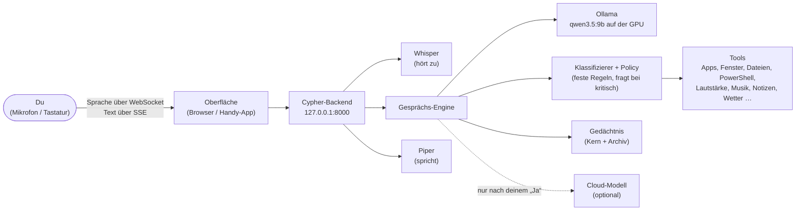

# Cypher

Ein Sprachassistent im Stil von JARVIS für deinen Windows-PC. Du sagst „Hey Cypher, wie spät ist es?“ und bekommst nach rund 2 Sekunden eine gesprochene Antwort. Alles läuft **lokal**: Das Sprachmodell rechnet in Ollama auf deiner Grafikkarte, Spracherkennung (Whisper) und Stimme (Piper) laufen auf der CPU. Die Cloud ist optional und wird nie automatisch benutzt.



Wie das im Detail zusammenspielt: [docs/ARCHITECTURE.md](docs/ARCHITECTURE.md).

## Was Cypher kann

| Bereich | Beispiele |
|---|---|
| Sprechen | „Hey Cypher, wie spät ist es?“, „Hey Cypher“ … Pause … „Wie wird das Wetter morgen in Bern?“. Unterbrechen per Tippen, Leertaste oder „Hey Cypher, stopp“. |
| PC steuern | „Mach die Musik leiser“, „Pause“, „Nächster Titel“, „Stell einen Timer auf 10 Minuten“, „Mach mir den Editor auf“, „Öffne Discord“, Fenster und Prozesse, Dateien auf allen Laufwerken (Löschen = Papierkorb), PowerShell-Befehle, Software über winget, Sperren/Herunterfahren, Helligkeit, Tastatur/Maus |
| Wissen & Nachschauen | Allgemeinwissen direkt; Wetter, Websuche, Webseiten zusammenfassen, Dateien finden, „Was läuft gerade?“, „Was siehst du auf meinem Bildschirm?“ |
| Notizen | „Schreib eine Notiz: Milch kaufen“ (mit Freigabekarte), „Zeig meine Notizen“ |
| Gedächtnis | „Merk dir, dass ich freitags Berufsschule habe“, „Vergiss das mit dem Kaffee“. Alles sichtbar und editierbar im Menü → Gedächtnis. |
| Handy | Über Tailscale mit HTTPS, Kopplung per QR-Code ([docs/MOBILE.md](docs/MOBILE.md)) |

Kritische Aktionen (endgültig löschen, installieren, herunterfahren …) brauchen deine Freigabe per Klick, Taste **J/N** oder per Sprache mit „Ja, ausführen“. Alles, was Cypher tut, steht im Audit-Log. Wie das genau entschieden wird: [Sicherheitsmodell der PC-Steuerung](#sicherheitsmodell-der-pc-steuerung).

## Schnellstart

**Voraussetzungen** (einmal installieren):
- Windows 10/11, eine Grafikkarte mit mindestens 8 GB Speicher (getestet: AMD RX 9070 XT, 16 GB)
- [Python 3.12](https://www.python.org/downloads/) (beim Installieren „Add python.exe to PATH“ anhaken)
- [Node.js LTS](https://nodejs.org/)
- [Ollama](https://ollama.com/download)

**Dann im Projektordner per Doppelklick:**

| Datei | Wofür |
|---|---|
| `setup.bat` | Einmal (und nach Updates): richtet alles ein, lädt Stimme und – nach Rückfrage – die Sprachmodelle (mehrere GB), prüft am Ende alles |
| `start_cypher.bat` | Startet Cypher unsichtbar im Hintergrund und öffnet **http://127.0.0.1:8000** |
| `stop_cypher.bat` | Beendet Cypher sauber |
| `doctor.bat` | Prüft die Installation und sagt auf Deutsch, was fehlt (ändert nichts) |
| `backup_cypher.bat` | Sichert Gedächtnis, Notizen und Verlauf nach `backups\`. Einspielen: `backup_cypher.bat --restore backups\<datei>.zip` |

Autostart bei der Anmeldung (optional, fragt einmal nach Administrator-Rechten):

```bash
backend\.venv\Scripts\python.exe scripts\autostart.py install
```

## Bedienung

- **Sprachansicht:** der leuchtende Kern in der Mitte. Oben stehen Modus, Mikrofon und die letzte Antwortzeit.
- **Modi:** *Hey Cypher* (hört dauerhaft auf das Aktivierungswort), *Tippen* (tippen, sprechen, Cypher merkt selbst, wann du fertig bist), *Funk* (tippen zum Starten, nochmal tippen zum Senden).
- **Tasten:** Leertaste = Mikrofon / unterbrechen, **Esc** = abbrechen, **J/N** = Freigabe ja/nein, **M** = Menü.
- **Menü (M):** Chat (schreiben statt sprechen), Gedächtnis, Aufgaben, Projekte, Handy, Diagnose, Audit-Log, Logs, Einstellungen (lokal/Cloud, Kosten).
- **Wenn etwas fehlt** (Ollama aus, Stimme fehlt …), steht oben ein Banner: was kaputt ist, was das heisst und was zu tun ist. Läuft es wieder, verschwindet das Banner von selbst. Ein Neustart ist nicht nötig.

## Sicherheit in Kürze

- Das Backend hört nur auf `127.0.0.1`. Das Handy kommt über `tailscale serve` (HTTPS, nur deine Geräte).
- Jede Anfrage braucht einen Zugangscode. Am PC holt die Oberfläche ihn selbst, andere Geräte koppeln sich einmal.
- Jede Aktion bekommt pro Aufruf eine **Stufe** (`safe`, `control`, `write`, `critical`), festgelegt von festen Regeln, nie vom Sprachmodell. Kritisches fragt vorher nach (siehe unten).
- **Prompt-Injection:** Was aus Dateien, Webseiten, Zwischenablage oder Bildschirm kommt, gilt als unsicher. Danach sind Gedächtnis und Zwischenablage-Schreiben für diesen Turn gesperrt, auch per Freigabe nicht zu öffnen. Alles ab `write` fragt in so einem Turn nach, auch bei ausgeschalteter Sicherheitsabfrage.
- **Cloud** nur, wenn du sie einschaltest (Einstellungen) oder bei einem Ausfall die angebotene Rückfrage mit „Ja“ beantwortest. Monatsbudget und Kostenzähler sind eingebaut.
- Kein Schlüssel im Repo: `.env` ist gitignored, `.env.example` beschreibt alle Einstellungen.

Details: [docs/ARCHITECTURE.md](docs/ARCHITECTURE.md#4-sicherheit).

## Sicherheitsmodell der PC-Steuerung

Cypher darf auf deinem PC fast alles, läuft aber **ohne Administratorrechte** und erhöht sich nie selbst. Das Sprachmodell schlägt nur vor. Ob etwas sofort läuft oder nachfragt, entscheidet ein fester Klassifizierer (`backend/app/security/classifier.py`) zusammen mit der Policy (`backend/app/security/policy.py`). Was der Klassifizierer nicht sicher einordnen kann, gilt als `critical`.

| Stufe | Bedeutung | Beispiele | Verhalten |
|---|---|---|---|
| `safe` | nur lesen | Uhrzeit, Ordner auflisten, Datei lesen, `Get-Process`, Fenster auflisten | läuft sofort |
| `control` | harmlos, umkehrbar | Lautstärke, Musik, App öffnen, Fenster minimieren, PC sperren, Helligkeit | läuft sofort |
| `write` | ändert Daten in deinem Benutzerordner | Datei schreiben, Datei löschen (in den Papierkorb), App beenden, Notiz | PC-Werkzeuge: läuft sofort. Notizen und Gedächtnis-Löschen: Freigabekarte |
| `critical` | kann echten Schaden anrichten | siehe nächste Liste | fragt nach, solange die Sicherheitsabfrage an ist |
| `blocked` | läuft nie | Selbst-Erhöhung (`Start-Process -Verb RunAs`), Eingaben in Cyphers eigene Oberfläche | wird abgelehnt |

**Kritisch** ist unter anderem: endgültig löschen (`Remove-Item`, ganze Ordner, ausserhalb deines Benutzerordners), schreiben ausserhalb deines Benutzerordners oder in den Autostart, Software installieren/deinstallieren, Herunterfahren, Neustart, Energiesparmodus, Dienste, geplante Aufgaben, Netzwerk- und Firewall-Einstellungen, Benutzerkonten und Berechtigungen, Zugangsdaten lesen (`.ssh`, `.env`, Browser-Cookies …), Programme oder Skripte aus Downloads/Temp, Kommandozeilen und Code-Hosts starten (PowerShell, cmd, regedit, python …), unbekannte Programme und URI-Schemata, Eingaben in ein Terminal, System- und Sicherheitsprozesse beenden, Cyphers eigene Dateien ändern und jeder PowerShell-Befehl, den der Klassifizierer nicht kennt.

### Sicherheitsabfrage an/aus

Menü → Einstellungen → **Sicherheitsabfrage für kritische Aktionen**. Standard: **an**.

- **Ausschalten** geht nur in zwei Schritten: erst „Ausschalten …“, dann eine Warnung mit der Wahl **„Nur für diese Sitzung“** (gilt bis zum nächsten Neustart von Cypher, danach ist sie wieder an) oder **„Dauerhaft ausschalten“** (in der Datenbank gespeichert, übersteht Neustarts). „Wieder einschalten“ gilt sofort und dauerhaft.
- Solange sie aus ist, zeigt die Kopfzeile **⚠ ABFRAGE AUS**, und `doctor.bat` meldet es als Warnung.
- Ändern lässt sie sich **nur in der Oberfläche im Browser direkt an diesem PC**: nicht vom Handy, nicht per Sprache, nicht durch ein Werkzeug von Cypher, nicht von einer anderen Webseite. Es gibt keine `.env`-Einstellung dafür.

**Was auch bei ausgeschalteter Abfrage bleibt:**

- **Audit-Log:** Jede Aktion steht im Menü → Audit-Log. Eine kritische Aktion, die ohne Nachfrage lief, steht dort als `auto_unconfirmed`. Jede Änderung des Schalters wird ebenfalls protokolliert.
- **Taint-Schutz:** Stammt ein Auftrag (auch) aus fremdem Inhalt (Webseite, Datei, Zwischenablage, Bildschirm), fragt alles ab `write` nach.
- **Rote Linie:** fragt immer, egal wie der Schalter steht: Formatieren/Partitionieren, Löschen von Systemordnern, Boot-Konfiguration, Defender/Firewall abschalten oder ändern, Cyphers Token, Konfiguration und Audit-Log. Einstellbar über `CRITICAL_RED_LINE` in der `.env`.
- **Sprachbestätigung:** Bei kritischen Aktionen und der roten Linie zählt per Sprache nur **„Ja, ausführen“**. Ein einfaches „Ja“ reicht nicht, und Cypher sagt dir das. Während die Frage läuft, ist das Mikrofon stumm (kein Selbst-Bestätigen durch das Echo). Am Bildschirm genügen Klick oder Taste **J**.

Bekannte Grenzen stehen in [docs/overhaul/FIX2-report.md](docs/overhaul/FIX2-report.md#grenzen-ehrlich): unter anderem erkennt die rote Linie Cyphers eigene Adresse in PowerShell-Web-Befehlen und in `open_app`, aber nicht in fremden Programmen wie `curl.exe`, und bei einem Auftrag aus fremdem Inhalt reicht per Sprache ein einfaches „Ja“.

## Konfiguration

Alle Einstellungen stehen kommentiert in `.env.example`; `setup.bat` kopiert sie nach `.env`. Die wichtigsten:

| Schlüssel | Standard | Bedeutung |
|---|---|---|
| `LOCAL_LLM_MODEL` / `LOCAL_LLM_FALLBACK_MODEL` | `qwen3.5:9b` / `qwen3.5:4b` | Sprachmodell in Ollama (Wahl begründet in `docs/overhaul/M5-report.md`) |
| `WHISPER_MODEL_SIZE`, `WAKE_WORD_MODEL` | `small`, `tiny` | Spracherkennung / Aktivierungswort |
| `WAKE_WORD_PHRASE` | `Hey Cypher` | Aktivierungswort |
| `VAD_SILENCE_MS` | `700` | So lange Stille, bis Cypher annimmt, dass du fertig bist |
| `MEMORY_CORE_MAX_TOKENS` | `400` | Grösse des Kern-Gedächtnisses |
| `CLOUD_LLM_ENABLED`, `CLOUD_LLM_API_KEY`, `CLOUD_LLM_MODEL` | aus, –, `gpt-6-luna` | Optionale Cloud (OpenAI Responses API) |
| `CLOUD_MONTHLY_BUDGET_USD` | `5` | Harte Kostengrenze pro Monat |
| `CRITICAL_RED_LINE` | `format,system_folders,boot,defender_firewall,cypher_secrets` | Rote Linie: fragt immer, auch bei ausgeschalteter Sicherheitsabfrage |
| `APP_ALIASES` | leer | Eigene App-Begriffe für „öffne …“ (`name=ziel`), ergänzen oder ersetzen die eingebaute Tabelle (Editor, Rechner, Browser …) |
| `TERMINAL_TIMEOUT_SECONDS` | `30` | Zeitlimit für einen PowerShell-Befehl im Vordergrund |
| `ALLOWED_DIRECTORIES` | leer | Begrenzt nur noch die Git-Werkzeuge. Die Datei-Werkzeuge arbeiten auf allen Laufwerken, bewertet vom Klassifizierer. Die Suche nach Dateinamen nutzt `SEARCH_DIRECTORIES` (leer = dein Benutzerordner). |
| `API_HOST` / `API_PORT` | `127.0.0.1` / `8000` | Adresse des Backends |

## Wake-on-LAN

Ein schlafender PC kann sich nicht selbst wecken, und ein Browser kann kein Magic Packet senden. Deshalb gibt es `scripts/wake_pc.py`: ein Skript ohne Abhängigkeiten, das du auf einem **anderen** Gerät im selben Heimnetz startest (`python wake_pc.py AA:BB:CC:DD:EE:FF`). Voraussetzungen am PC: Wake-on-LAN im BIOS, im Geräte-Manager „Wake on Magic Packet“ beim Netzwerkadapter, am besten per Kabel. `doctor.bat` prüft die Netzwerkkarte, sobald `WAKE_ON_LAN_MAC` gesetzt ist.

## Fehlerbehebung

Zuerst immer `doctor.bat`. Häufige Fälle:

| Symptom | Lösung |
|---|---|
| Banner „Ollama läuft nicht“ | Ollama starten (Startmenü) oder `start_cypher.bat`. Cypher verbindet sich von selbst neu. |
| Antworten sehr langsam (> 10 s) | `doctor.bat` → Zeile *Grafikkarte*: Liegt das Modell nicht komplett im Grafikspeicher, andere Modelle in Ollama beenden. Dauerhaft hilft die Benutzer-Umgebungsvariable `OLLAMA_MAX_LOADED_MODELS=1`. |
| Keine Stimme | `setup.bat` erneut (lädt die Piper-Stimme) |
| Mikrofon geht auf dem Handy nicht | Nur über die `https://…ts.net`-Adresse, siehe [docs/MOBILE.md](docs/MOBILE.md) |
| `start_cypher.bat` meldet „startet nicht“ | `logs\backend.err.log` ansehen, oder `start_cypher.bat -Foreground` zeigt die Fehler direkt |
| Port 8000 belegt | `stop_cypher.bat` (beendet auch ältere Cypher-Instanzen) |

## Entwicklung

```bash
cd backend && .venv\Scripts\python.exe run.py --reload
```

```bash
cd frontend && npm run dev
```

Der Vite-Dev-Server läuft auf http://localhost:5173 und spricht das Backend über `VITE_API_BASE_URL` aus `frontend/.env` an.

Tests:

| Was | Befehl (aus `backend/` bzw. `frontend/`) |
|---|---|
| Backend (pytest, ~830 Tests, ~1 min) | `.venv\Scripts\python.exe -m pytest -q` |
| Frontend (Vitest) | `npm test` |
| Lint, Typen, Format | `npm run lint`, `npx tsc -b`, `npm run format:check` |
| Browser-Smoke-Test (Playwright, im installierten Edge) | `npm run test:e2e` |
| **Abnahmetest** gegen eine isolierte echte Instanz | `.venv\Scripts\python.exe -m eval.acceptance` ([docs/ACCEPTANCE.md](docs/ACCEPTANCE.md)) |
| Befehls-Suite gegen das echte Modell (ohne Wirkung auf den PC) | `.venv\Scripts\python.exe -m eval.command_suite` |
| Sprach-Szenarien über den echten WebSocket | `.venv\Scripts\python.exe -m eval.voice_client all` |

## Dokumentation

| Datei | Inhalt |
|---|---|
| [docs/ARCHITECTURE.md](docs/ARCHITECTURE.md) | Aufbau, Datenflüsse, Sicherheit, Entscheidungen mit Messwerten |
| [docs/MOBILE.md](docs/MOBILE.md) | Handy über Tailscale (HTTPS, Kopplung, App-Verknüpfung) |
| [docs/ACCEPTANCE.md](docs/ACCEPTANCE.md) | Abnahme: Definition of Done, Ergebnis, manuelle Checkliste |
| [docs/DEPENDENCIES.md](docs/DEPENDENCIES.md) | Alle Abhängigkeiten mit Lizenz (nur MIT/Apache/BSD) |
| [cypher-projektplan.md](cypher-projektplan.md) | Ziel, Stand, nächste Schritte, bewusst nicht im Umfang |
| [docs/overhaul/](docs/overhaul/) | Audit, Plan und Berichte M0–M8 der Überholung |
