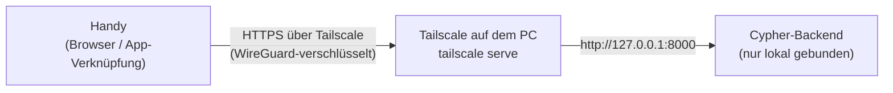

# Cypher auf dem Handy

Ziel: Du öffnest auf dem Handy eine App-Verknüpfung, sprichst mit Cypher
(Mikrofon!) und es läuft trotzdem alles auf deinem PC. Nichts wird ins
offene Internet oder in dein WLAN gestellt.

## So funktioniert es



- **Tailscale** baut ein privates Netz („Tailnet“) nur aus deinen eigenen
  Geräten. Nur Geräte, die mit deinem Konto angemeldet sind, sehen den PC.
- **`tailscale serve`** gibt Cypher im Tailnet eine HTTPS-Adresse wie
  `https://cypher-pc.tail1234.ts.net`, mit echtem Zertifikat. Das braucht
  der Handy-Browser: **Mikrofonzugriff gibt es nur über HTTPS** (oder auf
  `localhost`).
- Das Cypher-Backend bleibt auf `127.0.0.1` gebunden. Du musst an der
  `.env` nichts ändern und keine Firewall-Regel anlegen.

> **Nicht `tailscale funnel` verwenden.** Funnel stellt den Dienst ins
> öffentliche Internet. `serve` bleibt im Tailnet.

## Einmalig einrichten (ca. 10 Minuten)

### 1. Tailscale installieren

1. PC: [tailscale.com/download/windows](https://tailscale.com/download/windows)
   installieren und anmelden.
2. Handy: Tailscale-App aus dem App Store oder Play Store, **mit demselben
   Konto** anmelden.

### 2. HTTPS-Zertifikate im Tailnet erlauben

In der Tailscale-Verwaltung ([login.tailscale.com/admin/dns](https://login.tailscale.com/admin/dns)):

1. **MagicDNS** einschalten, falls es aus ist.
2. Unter **HTTPS Certificates** auf **Enable HTTPS** klicken.

> **Datenschutz:** Zertifikate landen in öffentlichen
> Certificate-Transparency-Logs. Dort steht dann der **Gerätename** des
> PCs mit der Tailnet-Adresse (z. B. `silvans-gaming-pc.tail1234.ts.net`).
> Enthält der Name etwas Persönliches, benenne den PC in der
> Tailscale-Verwaltung **vorher** um (Machines → … → Edit machine name),
> z. B. in `cypher-pc`.

### 3. Cypher im Tailnet freigeben

In einer Eingabeaufforderung auf dem PC:

```bash
tailscale serve --bg 8000
```

- `--bg` heisst: läuft dauerhaft im Hintergrund weiter, auch nach einem
  Neustart. Du machst das nur einmal.
- Beim ersten Mal zeigt Tailscale eventuell einen Link, über den du
  `serve` für das Tailnet freischalten musst. Öffne ihn und bestätige.
- Nachsehen, was freigegeben ist: `tailscale serve status`.
- `doctor.bat` zeigt danach in der Zeile **Handy** ✓ und die Adresse an.

### 4. Handy koppeln

1. Am PC Cypher öffnen, Menü (Taste **M**) → **Handy**.
2. Den **QR-Code** mit der Handy-Kamera scannen. Der Link enthält den
   Zugangscode und koppelt das Handy einmalig. Danach entfernt die Seite
   den Code sofort wieder aus der Adresszeile.
3. Klappt das Scannen nicht: auf dem Handy die Adresse öffnen und den
   **Kopplungscode** von Hand eingeben (Menü → Handy → Anzeigen).

Warum nicht automatisch wie am PC? Am PC holt sich die Oberfläche den
Zugangscode selbst (`/api/auth/session`). Das klappt aber nur bei Anfragen
direkt von diesem PC. Anfragen über `tailscale serve` erkennt Cypher an
den Proxy-Headern (`X-Forwarded-For`, `Tailscale-User-Login`) und
behandelt sie als fremdes Gerät. Darum braucht das Handy den Code einmal.

### 5. Als App auf den Startbildschirm

- **Android (Chrome):** Menü ⋮ → **App installieren** bzw.
  **Zum Startbildschirm hinzufügen**.
- **iPhone (Safari):** Teilen-Symbol → **Zum Home-Bildschirm**.

Beim ersten Tippen auf das Mikrofon fragt der Browser nach der
Berechtigung. Wähle **Zulassen**.

## Was geschützt ist

| Schutz | Wie |
|---|---|
| Nur deine Geräte | Tailnet: nur Geräte mit deinem Tailscale-Konto erreichen den PC. |
| Verschlüsselt | WireGuard (Tailscale) und zusätzlich HTTPS bis zum PC. |
| Zugangscode | Jede API-Anfrage braucht den Token. Das Handy bekommt ihn nur über die Kopplung. |
| Keine Selbstbedienung | Über `serve` gibt es weder den Token ohne Kopplung noch „Cypher beenden“. Das geht nur direkt am PC. |
| Brute-Force | Falsche Codes sperren nur das Gerät, das sie schickt (gezählt pro `X-Forwarded-For`), nicht den PC. |
| Freigaben | Riskante Aktionen brauchen auch auf dem Handy deine Bestätigung (Karte), alles steht im Audit-Log. |

### Handy verloren?

1. In der Tailscale-Verwaltung das Gerät entfernen (Machines → … →
   Remove). Danach erreicht es den PC nicht mehr.
2. Zusätzlich den Zugangscode erneuern: `stop_cypher.bat`, dann
   `data\secrets.json` löschen (steht ein `USER_TOKEN` in der `.env`,
   diesen ändern), dann `start_cypher.bat`. Alle anderen Geräte müssen
   sich danach neu koppeln.

## Wieder abschalten

```bash
tailscale serve --https=443 off
```

Alles von `serve` zurücksetzen: `tailscale serve reset`.

## Ohne HTTPS (nur Chat)

Willst du kein Zertifikat, kannst du das Backend direkt an die
Tailscale-IP binden (`API_HOST=100.x.y.z` in der `.env`). Dann
funktionieren Chat und Menü über `http://100.x.y.z:8000`, aber **kein
Mikrofon**. Der Browser erlaubt es ohne HTTPS nicht. Cypher startet in
diesem Modus nur mit einem echten, zufälligen Token. Empfohlen bleibt
`tailscale serve`.

## Wake-on-LAN

Ein schlafender PC ist auch im Tailnet offline: Tailscale läuft ja auf
ihm. Zum Aufwecken braucht es ein zweites Gerät im selben Heimnetz
(`scripts/wake_pc.py`). `doctor.bat` prüft, ob deine Netzwerkkarte
„Wake on Magic Packet“ aktiviert hat.

## Fehlerbehebung

| Symptom | Ursache / Lösung |
|---|---|
| Handy: Seite lädt nicht | Tailscale-App auf dem Handy aktiv? Gleiches Konto? `tailscale serve status` am PC zeigt die Freigabe? Läuft Cypher (`start_cypher.bat`)? |
| „Zertifikat ungültig“ / Warnung | HTTPS Certificates im Tailnet nicht aktiviert (Schritt 2). Nach dem Aktivieren `tailscale serve --bg 8000` erneut ausführen. |
| „Das Mikrofon geht nur über HTTPS …“ | Seite über `http://` geöffnet. Nur die `https://…ts.net`-Adresse erlaubt das Mikrofon. |
| „Kopplungscode ungültig“ | Code am PC neu anzeigen (Menü → Handy). Wurde `secrets.json` gelöscht, gilt ein neuer Code. |
| Menü → Handy zeigt keinen QR-Code | `tailscale serve` ist nicht eingerichtet oder zeigt auf einen anderen Port (Schritt 3). Nach dem Einrichten das Menü nach ca. 30 Sekunden neu öffnen. |
| Antworten kommen, aber keine Stimme | Handy stumm/Medienlautstärke? Beim ersten Mal einmal auf den Bildschirm tippen (Browser erlauben Ton erst nach einer Berührung). |

## Manuelle Prüfliste

Auf dem Entwicklungs-PC ist Tailscale nicht installiert. Dieser Weg ist
darum durch Tests abgesichert (Proxy-Erkennung, Kopplungslink, QR-Code,
`wss://` unter HTTPS), aber nicht live mit einem Handy durchgespielt.
Beim ersten Einrichten bitte einmal abhaken:

- [ ] `doctor.bat` → Zeile **Handy** ✓ mit `https://…ts.net`-Adresse
- [ ] Menü → Handy zeigt QR-Code; Scan öffnet Cypher auf dem Handy ohne Code-Eingabe
- [ ] Neuladen auf dem Handy: bleibt gekoppelt
- [ ] Menü → Handy auf dem **Handy** zeigt „Dieses Gerät ist mit Cypher gekoppelt.“ (kein Code)
- [ ] Mikrofon-Berechtigung erteilt, „Wie spät ist es?“ wird gesprochen beantwortet
- [ ] Notiz anlegen → Freigabe-Karte erscheint auf dem Handy, Bestätigen klappt
- [ ] App-Verknüpfung auf dem Startbildschirm startet im Vollbild
- [ ] `tailscale serve --https=443 off` → Handy erreicht Cypher nicht mehr; `tailscale serve --bg 8000` → wieder da
